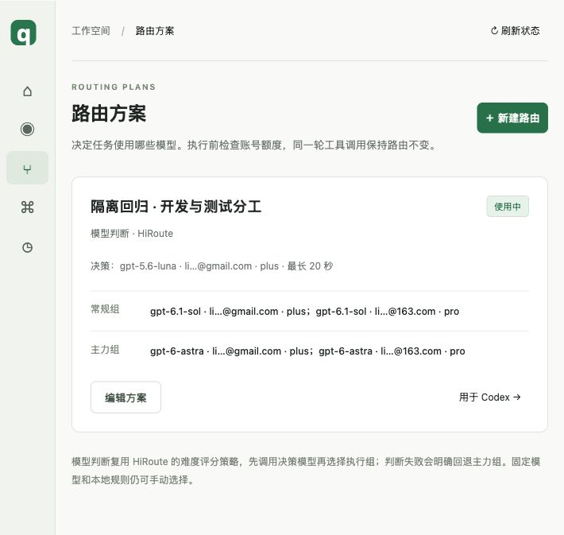

# 隔离回归结果（2026-11-06）

**最新结论：指定旧聊天副本显式切到 Plus 后的桌面原生 IAB 回归已通过；用户当前聊天未接入，生产 qpool 保持关闭。** 本页保留各轮次的历史结论，最新 GUI 验证见下节；不外推所有插件和所有旧提供方的兼容性。

## 评审指出的两项 P2 补修

本轮仅在分支内修改与隔离测试，没有重接用户当前聊天，也没有真实模型推理或 GUI 重跑。修复包括：

- 官方恢复集合同时读取请求回执、`session_bindings` 和 `legacy_bindings`，采用当前绑定的真实模型，覆盖“选路成功、适配器或后续校验失败、回执尚未创建”的情况。账本缺失、不完整、绑定损坏或模型不可确认时保留接入配置。
- 如果首次选路就无候选，绑定与回执都没有写入，恢复仍检查引擎中的 qpool 别名；发现未知别名会**明确拒绝退出并保留入口**，提示先为该聊天选择真实模型，不猜账号或恢复模型。
- 原生认证账号与当前执行源分开校验。原生登录 Pro、自动执行 Plus 的会话可以明确迁回 Pro；已完成一次迁移后也可安排下一次，pending 计划仍拒绝重复安排。工具续轮保持当前执行源，新用户轮次才应用迁移。
- 执行源保存在已有 `previous_binding` 快照中，没有新增数据库字段；旧首次迁移记录可读取。但旧二进制未必理解“pending 执行源不同于认证源”，不能把 schema 未变当作透明降级保证。回滚旧程序前应先完成 pending 迁移；本轮未执行生产升级或降级。

真实临时 Codex 引擎验证了：未知 alias 且零绑定／零回执时保留配置与历史；有有效绑定但零回执时，通过产品恢复路径将同 ID 聊天改为官方真实模型，历史原字节前缀保留。这是协议恢复验证，不是模型推理或 GUI 验证。独立审查复核了恢复范围和账号分离逻辑，未独立运行本轮测试。

最终全量回归 **218 项通过，111.085 秒**；新增 9 项回归覆盖绑定与回执恢复集合、缺失／损坏账本、首次失败、未知别名、自动 Plus 后迁回 Pro、重复显式迁移和当前执行源身份校验。定向结果为桌面 31 项、迁移 18 项、真实引擎协议 4 项通过；Python 编译与 diff 检查通过。退出检查确认主配置提供方为官方 `openai`、没有 `openai_base_url`，生产接入状态与 qpool LaunchAgent 均不存在，8765 与 50338 无监听。原临时聊天历史未变。

本轮记录见[两项 P2 补修验证](artifacts/isolated-regression-20261106/p2-review-fixes.json)。没有提交、合并或启用生产接入。

## 用户完成的真实桌面 GUI 回归

2026-11-06，用户手动打开独立 profile，向 `qpool GUI isolated QA - history copy` 发送测试提示。核验直接读取独立账本及该副本持久化工具记录，没有向原聊天发测试消息或操控其 UI。

| 核验项 | 独立记录中的实际证据 | 结论 |
| --- | --- | --- |
| 执行账号 | 原 Pro 基线 1 条；用户 GUI 验收阶段随后 6 条全部为 Plus，均 completed | 通过 |
| 执行模型 | 上述 6 条 selected model 与上游 actual_model 均为 `gpt-6.1-sol` | 通过 |
| 原位迁移 | 同一聊天 ID，迁移状态 selected，最终执行绑定为 Plus；认证源仍为原 Pro | 通过 |
| 历史 | 副本保留源历史逐字节前缀；Plus 首次和最终回答均回忆 `GUI_HISTORY_1106` | 通过 |
| 原生浏览器 | 实际 `js` 调用 `cua.createBrowserTab("iab", "http://127.0.0.1:50338/#routes", ...)` | 通过 |
| 页面操作 | `click(7)` 后 AX 返回账号页的 3 个账号 / 24 个模型；`click(10)` 后返回路由页 | 通过 |
| 调试与截图 | `dev.logs({levels:["error"]})` 实际输出 `[]`；screenshot 返回 input_image，文件存在并已查看 | 通过 |
| 主环境隔离 | 主配置与原临时聊天历史均与本次 handoff 基线哈希一致，生产接入状态不存在 | 通过 |

Plus 的 6 次主会话请求始于北京时间 12:16:27 至 12:17:20，最后一次 10.077 秒后完成；浏览器调用和结果均在该同 ID 聊天中。截图显示活动方案为“隔离回归 · 开发与测试分工”，常规 Sol、主力 Astra，两组顺序均为 Plus → Pro。

隔离账本另有 13 条 Pro 请求，包括上述基线及其他会话请求，其中 1 条为明确的 `codex-auto-review` 原生审批。不能将“目标主会话的六次执行全部走 Plus”扩大为“整个桌面的所有请求都用 Plus”。其他原生具体模型请求仍受各自源账号绑定约束。

本轮走的是**明确安排的旧聊天 Pro → Plus 迁移**，并保留原 Sol 模型完成浏览器工具续轮；它不独立证明新聊天初次分配、Astra 分类触发、所有插件的授权或完整网络抓包能力。前面的引擎分类、重启和恢复测试仍按各自范围计入证据。

验收后已停止隔离 50338 网关并删除临时登录副本；8765 与 50338 均无监听，qpool LaunchAgent 为 0。没有把当前聊天或默认配置接回 qpool。用户可以关闭临时桌面窗口，聊天副本及脱敏证据保留。证据已独立只读复核，审查者没有重新执行 GUI 或模型请求。

- [GUI 实际调用、Plus 回执和清理证据](artifacts/isolated-regression-20261106/gui-plus-browser-evidence.json)
- [实际截图](artifacts/isolated-regression-20261106/gui-plus-browser-routes.jpg)

## 后续修复：保留原生提供方身份

本节为同日后续结果，后文 196 项测试及 58289 端口为此前一轮记录。本轮最终 **209 项测试通过，104.551 秒**；Python 编译、前端语法和 diff 检查通过。所有改动仍在 `codex/isolated-desktop-regression`，未提交、合并或接回用户聊天。

真实排障确认了两处此前测试未覆盖的问题：

1. [官方配置规则](https://learn.chatgpt.com/docs/config-file/config-advanced)明确项目配置忽略 `openai_base_url`、`model_provider` 等敏感转发项，不能用项目配置证明桌面已路由。
2. 桌面自带 `0.166.0-alpha.6` 引擎在默认提供方为自定义 qpool 时，拒绝恢复原 `openai` 聊天；即使 resume 指定 `modelProvider=openai` 仍返回 `modelProviderMismatch`。本轮独立配置真实复现了该错误。

产品接入现在保留内置 `openai` 身份，通过用户级 `openai_base_url` 进入 `/legacy/v1`，不定义保留的 `model_providers.openai`。新聊天的执行账号与原生认证账号分开保存，首轮按方案顺序选 Plus；已有历史保持原账号，明确安排迁移后才切换。原生首轮包含单独环境消息和 developer `additional_tools` 目录，已按真实形状兼容；助手输出、加密推理、工具结果和其他历史项不会因此触发自动跨账号。

### 无命令行覆盖的真实配置验证

使用全新隔离目录和端口 58936，在独立用户级配置根目录启动桌面自带引擎；**没有使用 `-c` 覆盖提供方或转发地址**。

| 阶段 | 真实结果 |
| --- | --- |
| 新聊天首轮 | Plus / gpt-6.1-sol，completed |
| 获准旧聊天完整副本，原 ID | Pro / gpt-6.1-sol，completed |
| 同 ID 明确迁移 | Plus / gpt-6.1-sol，回忆 `PROFILE_HISTORY_1106`，completed |
| 同一副本代码 Review | Plus / gpt-6-astra，completed |

这四阶段有对应的隔离网关回执。该隔离账本共 7 条 completed，另 3 条是修复前“请求成功但仍选 Pro”的排障请求，**不算 Plus 优先验收通过**。更早的自定义提供方复现使用另一独立目录和端口 57473。

### 实际退出与官方续聊

审查发现，仅恢复全局配置还会留下聊天级 `qpool-auto` 别名，官方无法执行该模型。现在恢复流程只处理**本机请求账本可确认、且当前仍用 qpool 别名**的聊天，将其模型恢复为最后选定的真实模型；不会把所有官方聊天交给恢复流程。

真实临时引擎协议测试确认：owned alias 恢复成 Sol；无账本归属的 alias 和已使用真实 Astra 的聊天历史逐字节不变。恢复失败保留接入配置与备份，允许重试。旧自定义提供方的恢复仍走独立兼容分支，不能据此推断所有旧 provider 聊天已通过新版 GUI 验证。

随后先**停止 58936 网关**，在隔离目录实际执行产品 `connect(install_background=False)` 与 `restore()`，不安装 LaunchAgent。恢复后同一旧聊天 ID、不覆盖模型，读回 `openai / gpt-6-astra`，官方真实续轮 completed，并再次回忆出历史标记。

### GUI 边界与清理

独立桌面 profile 准备器只复制获准临时聊天及 access-only 登录，不复制 refresh token、浏览器 profile、插件或授权；检查精确的隔离 endpoint，拒绝残留自定义提供方。它仅输出独立启动命令，没有启动或控制 GUI。安装版本的独立 user-data 入口来自当前程序实现观察，不承诺是稳定公开接口。

宿主 CUA 对 `com.openai.codex` 明确返回 `Computer Use is not allowed ... for safety reasons`。因此本轮**没有完整 GUI 聊天经 qpool 调用原生浏览器的通过结论**；引擎配置验证、此前浏览器中继与 GUI 验收分别记录。完整 GUI 仍是接回前的未完成项。

结束检查：8765、57473、58936 均无监听，qpool LaunchAgent 为 0，生产桌面接入状态文件不存在；两份新增临时登录及适配器凭据均已清理。主配置 SHA-256 仍为 `cb18547233ce07a78de5458d06a4bfd386089bb6a0c3692de25727af3df7bcf0`，源临时聊天历史逐字节未变。新增代码和恢复范围已经独立只读复核，审查者未运行本轮真实推理。

- [后续配置、官方续聊与清理证据](artifacts/isolated-regression-20261106/builtin-followup.json)
- 可复验脚本：`scripts/isolated_desktop_qa.py`、`scripts/isolated_desktop_config_probe.py`、`scripts/isolated_builtin_restore_probe.py`。需独立 runtime 和明确的 `--live`；不应对生产目录执行。

## 此前隔离轮次

本轮始终保持生产 8765 关闭、主 Codex 官方直连。测试使用独立端口 58289、独立账本、
独立适配器及 CODEX_HOME；没有安装自动启动服务。基线为 `1e49242` 加本轮工作区修复，
受测源文件哈希见[脱敏证据](artifacts/isolated-regression-20261106/evidence.json)。

## 验收矩阵

| 项目 | 真实观察 | 结论 |
| --- | --- | --- |
| 旧聊天历史续接 | 获准临时聊天的完整副本保留原 ID、加密推理和工具历史，桌面自带引擎完成 Pro 轮次后原地切 Plus，成功回忆上一轮标记 | 通过，范围是隔离副本 |
| 同账号按任务换模型 | 同一副本中，测试框架任务实际使用 Plus / gpt-6.1-sol；代码 Review 实际使用 Plus / gpt-6-astra | 通过 |
| 保存／重新启用 | 保存并重新启用完全相同方案，同一副本继续成功 | 通过 |
| 网关重启 | 在无在途请求时真实停止并重启隔离网关，同一副本继续使用 Plus 并保留历史标记 | 通过 |
| 新任务 Plus 优先 | 独立工具会话的首条执行实际选择 Plus / gpt-6.1-sol，工具结果续轮保持账号和模型 | 通过 |
| Plus 耗尽后回退 | 只在隔离账本模拟一致的耗尽快照，实际执行选择 Pro / gpt-6-astra；之后还原快照 | 通过，真实 Pro 执行＋合成耗尽条件 |
| 决策分类 | 6 条真实模型判断全部符合用户分工，没有格式回退 | 通过，样本有限 |
| 原生 IAB 工具往返 | Plus 实际产生工具请求，宿主原生 IAB 读取页面、截图和 error 日志，再把结果交回同一 Plus 会话完成续轮 | 通过，宿主工具中继 |
| 完整桌面 GUI 聊天经网关调用浏览器 | 临时桌面聊天的浏览器操作成功，但宿主未采用项目级转发配置，隔离网关没有该阶段回执 | **未通过，不能用中继测试替代** |

完整副本测试通过桌面自带 `codex-cli 0.166.0-alpha.6` 的 app-server 协议驱动，
不是把独立浏览器自动化脚本冒充桌面聊天。副本与原临时聊天处于不同 CODEX_HOME。
测试期间原临时聊天历史文件及主配置逐字节未变；真实桌面浏览器基线阶段则向获准临时聊天
追加了两轮测试消息，这些消息保留作为记录。

## 真实模型与回执

旧聊天副本的六个阶段均有 completed 回执：

1. Pro / gpt-6.1-sol：读取已有浏览器检查历史并建立测试标记。
2. Plus / gpt-6.1-sol：显式账号迁移后回忆标记，首次不同时更换模型。
3. Plus / gpt-6.1-sol：测试框架设计。
4. Plus / gpt-6-astra：代码 Review。
5. Plus / gpt-6.1-sol：重新启用相同方案后继续。
6. Plus / gpt-6.1-sol：真实重启隔离网关后继续。

六条分类样本是测试执行、测试框架设计、复杂失败分析、代码 Review、开发实现和架构方案，
前三项 regular，后三项 primary。决策模型为 Plus 的 gpt-5.6-luna；它是独立的判断调用，
不能与 Sol/Astra 的执行用量混淆。

本轮执行账本共 10 条 completed，API 执行 0 次。包含一次回退夹具排障请求：初次只改了
条目时间、未同步批次时间，被系统正确识别为未知并回读真实额度，实际仍选 Plus，**不算作
回退测试通过**。修正隔离夹具的批次一致性并使用新会话后，真实 Pro 回退才通过。
Plus 决策模型也受耗尽条件影响，因此该回退使用保守 primary / Astra，未把它伪报为 Sol。

## 实际发现并修复的问题

- 决策模型偶发返回不符合约定的 JSON，普通测试因此回退 Astra：新增严格结构化输出，
  仍校验概率范围与分布；修复前 6 样本中 3 次格式失败，修复后 6/6 无回退。
- 压缩后可见用户消息数下降，迁移计划长期无法到达旧计数：工具／压缩续轮只更新安全基线，
  真正的新用户轮次才切账号。
- 源账号耗尽导致无法迁移到可用目标：源只验身份，目标验证身份、额度和实际适配器模型。
- 原模型不在新分组中导致旧聊天无法迁移：首轮允许已验证的原模型过渡，随后才按新分组选模。
- 目标被换号时可能先写迁移状态后失败：在选定前检查目标凭据和适配器，预检失败保留原绑定。
- 归档聊天恢复被引擎拒绝：按官方协议临时取消归档，恢复后还原归档状态，异常也还原。
- 审批辅助聊天恢复时被误改普通模型：保留 `codex-auto-review`。
- 新引擎禁止改变旧聊天 provider ID：保留旧 ID 的官方 OAuth 直连兼容定义，同时还原默认
  官方提供方，移除本地网关令牌和自启动；官方直连兼容端点经过临时真实推理验证。
- 兼容恢复后无法再次接入：下一次显式接入使用新 provider ID，不覆盖已恢复旧聊天的官方传输。

## 验证方法和边界

- 最终隔离全量回归：**196 项通过，97.690 秒**。包含真实临时引擎协议恢复测试。
- Python 编译、前端语法、diff 空白检查通过。
- 独立只读审查复核了上述修复；审查者未独立运行真实推理，不把该审查当作另一份实测结果。
- 浏览器使用宿主 `mcp__cua_repl` 的原生 IAB，没有安装浏览器运行时或扩展权限。
  读取、导航、路由编辑器查看、截图和控制台 error 日志成功；error 日志为 `[]`。
  AX 点击遇到宿主 shadow-root 检查错误，使用同一宿主提供的语义定位点击后成功。
- 只读网页体验评分 **4/5**：页面与规则可核对，未全面验证编辑保存、窄屏和可访问性；
  该分数不是整个 qpool 或桌面集成的评分。
- 没有完整 CDP／网络抓包验证，没有真实耗尽订阅，也没有进行付费 API 推理。
- 尚未验证宿主 GUI 聊天采用隔离转发配置。后续需要可隔离的桌面配置入口或独立桌面测试
  profile；在此之前继续保持用户聊天官方直连，不能声称全部修好或批准接回。
- 原位发布覆盖普通异常回滚；跨文件与 SQLite 的进程强杀一致性没有做破坏性测试。

## 清理与证据

临时桌面测试聊天已恢复原工作目录、提供方、模型、归档及权限元信息，历史与测试消息保留。
隔离访问令牌副本和适配器临时凭据在结束时清理，测试账本与历史副本保留于本机忽略目录
`.qpool/isolated-qa-20261106/`，不纳入 Git。

主配置测试前后 SHA-256：
`cb18547233ce07a78de5458d06a4bfd386089bb6a0c3692de25727af3df7bcf0`。

- [脱敏模型判断与执行证据](artifacts/isolated-regression-20261106/evidence.json)
- [实际页面截图](artifacts/isolated-regression-20261106/routes.jpg)
- [页面任务分工配置](artifacts/isolated-regression-20261106/rules-editor.jpg)

